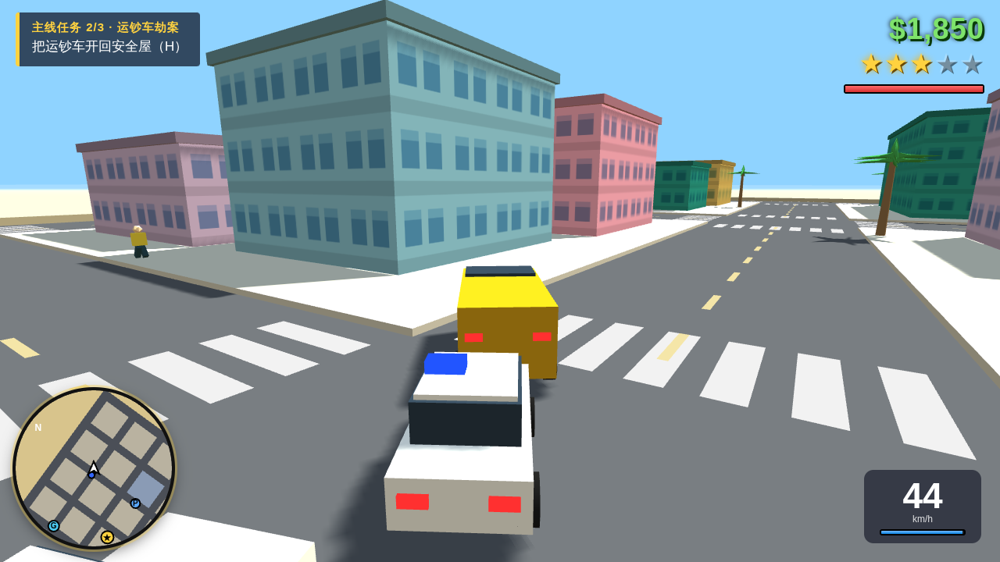
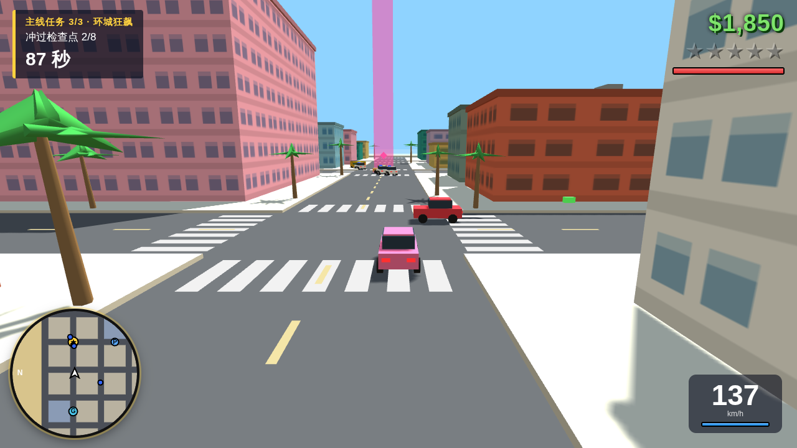
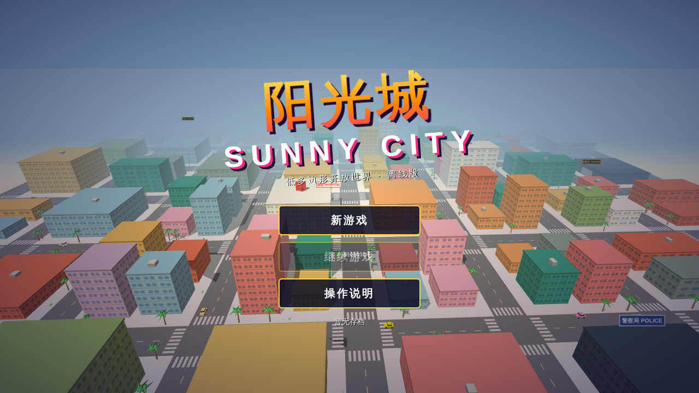

# 阳光城 SUNNY CITY

低多边形 GTA 风格开放世界，纯本地文件，不需要联网。

## 怎么玩
解压后双击 `index.html`（Chrome / Edge / Firefox 均可）。

- W/S 或 ↑/↓：前进/后退；A/D 或 ←/→：转向；空格：手刹；Shift：冲刺
- F：上车 / 偷车 / 下车；E：在改装店门口打开改装店；Esc/P：暂停与存档
- 触屏设备自动显示虚拟按键

## 内容
- 8×8 网格街区、海滩、公园、改装店、警察局、医院、安全屋
- 车流 AI、行人 AI、可偷可开的车（含警车、运钞车）
- 通缉 1–5 星，警车按路网追捕；远离警车星级自动下降；被贴住停车会 BUSTED
- 主线：急件快递 → 运钞车劫案 → 环城狂飙
- 赚钱：任务奖励、街头现金；改装店 4 项升级各 3 级 + 喷漆清通缉
- 小地图（随车头旋转）、开始界面、localStorage 存档（自动 + 手动）

## 文件
- index.html / style.css / game.js：游戏本体
- lib/three.min.js：Three.js r149（本地）
- tools/shoot.py：无头浏览器自动截图测试（需 playwright）

## 截图

